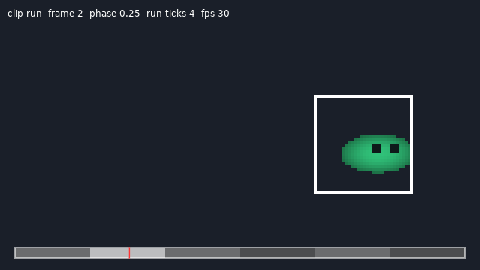

# desAnim8 v0.10.0

[](https://buymeacoffee.com/legendaryredfox)

**[Português (BR)](#português-br)** | **[English](#english)**



---

<a id="português-br"></a>

# Português (BR)

Biblioteca de animação de sprites para **LÖVE 11.5**, sem dependências, organizada em módulos pequenos e também disponível como um único arquivo. Desenha com `love.graphics.draw` e Quads, então roda também em camadas compatíveis com LÖVE para consoles.

Este projeto foi baseado no [anim8 do kikito](https://github.com/kikito/anim8). Se você gostar, considere apoiar o trabalho dele.

## Uma história engraçada

Nem tanto, mas eu gosto do LÖVE e um dia resolvi tentar fazer jogos para o PSP, que é um portátil ótimo. Acabei criando algumas ferramentas e adicionando um pouco de código a repositórios que já existiam. Aí um amigo me disse que talvez houvesse algumas pessoas para quem esse código fosse útil, e eu decidi torná-lo público.

Este código será atualizado quando eu tiver tempo livre para o projeto, então tenha paciência.

## Avisos

- Não sou um desenvolvedor experiente de Lua ou LÖVE, tenha isso em mente ao usar o código
- Fique à vontade para abrir issues, mas, se for abrir, inclua uma descrição detalhada

## Sumário

[Início rápido](#início-rápido) · [Instalação](#instalação) · [Grid](#grid) · [Criando animações](#criando-animações) · [Desenhando](#desenhando) · [Tempo e reprodução](#tempo-e-reprodução) · [Eventos](#eventos) · [Mudanças em tempo de execução](#mudanças-em-tempo-de-execução) · [Dados por frame](#dados-por-frame) · [Atlas e Aseprite](#atlas-e-aseprite) · [Estilo de desenho](#estilo-de-desenho) · [Clips, camadas e lotes](#clips-camadas-e-lotes) · [Estado salvo](#estado-salvo) · [Referência](#referência-dos-métodos) · [Migrando do anim8](#migrando-do-anim8) · [Consoles](#usando-em-consoles-psp--vita--ps3) · [Dicas](#dicas-de-spritesheet) · [Testes](#testes-e-exemplo)

---

## Início rápido

```lua
local desAnim8 = require 'libraries.desAnim8'

local image, player

function love.load()
    love.graphics.setDefaultFilter('nearest', 'nearest')   -- pixel art nítida; antes de newImage
    image = love.graphics.newImage('player.png')
    local g = desAnim8.newGrid(48, 48, image:getWidth(), image:getHeight())

    player = {
        x = 400, y = 300,
        animations = {
            idle = desAnim8.new(image, g('1-6', 1), 0.12),
            run  = desAnim8.new(image, g('1-8', 2), 0.08),
        }
    }
    player.current = player.animations.idle
end

function love.update(dt)
    player.current:update(dt)
end

function love.draw()
    player.current:draw(player.x, player.y)
end
```

Um projeto completo e executável está em `examples/showcase` (`love examples/showcase`): clips, flip, hit-stop, rastro, onion skin, lote de sprites e linha do tempo com scrub.

---

## Instalação

desAnim8 não tem dependências além do próprio LÖVE. Há duas formas de usar:

**Módulos** (para desenvolvimento): copie `desAnim8.lua` **e a pasta `desAnim8/`** para o mesmo lugar do seu projeto (por exemplo `libraries/desAnim8.lua` e `libraries/desAnim8/`). Os módulos se acham sozinhos a partir do nome que você passou ao `require`.

**Arquivo único** (para consoles ou quando `require` de vários arquivos atrapalha): copie só `dist/desAnim8.lua`. Ele é gerado pelos módulos com `lua tools/bundle.lua`, traz o próprio `require` interno e não mexe em `package.path`.

```lua
local desAnim8 = require 'libraries.desAnim8'   -- ajuste o caminho; vale para as duas formas
```

Também há um rockspec: `luarocks make desanim8-0.10.0-1.rockspec`.

Estrutura: `desAnim8.lua` monta a API; `desAnim8/` tem o núcleo (`util`, `timing`, `options`, `animation`), os módulos que acrescentam métodos à animação (`playback`, `timeline`, `events`, `frameinfo`, `render`, `state`) e os recursos independentes (`grid`, `constructors`, `atlas`, `sheet`, `set`, `composite`, `batch`, `watcher`, `debug`, `shaders`).

**Versões suportadas:** LÖVE 11.5 (a última versão estável), LuaJIT 2.1 e Lua 5.1 até 5.5. O código usa só o subconjunto comum dessas versões. As partes que dependem de mais do que `love.graphics.newQuad` e `love.graphics.draw` estão marcadas como **[LÖVE]** neste documento e nunca tocam na API do LÖVE ao carregar o módulo.

Há anotações LuaCATS no arquivo, então editores com `lua-language-server` mostram tipos e autocompletar.

---

## Grid

Um grid divide um spritesheet em posições de frame endereçáveis por coluna e linha.

```lua
local g = desAnim8.newGrid(frameWidth, frameHeight, imageWidth, imageHeight [, left, top, border, inset])
local g = desAnim8.newGridFromImage(image, frameWidth, frameHeight [, left, top, border, inset])   -- lê o tamanho da imagem
```

| Parâmetro | Padrão | Descrição |
|---|---|---|
| `frameWidth`, `frameHeight` | nenhum | Tamanho de um frame em pixels |
| `imageWidth`, `imageHeight` | nenhum | Tamanho total do spritesheet (`image:getWidth()` / `image:getHeight()`) |
| `left`, `top` | `0` | Deslocamento da origem do grid dentro da imagem |
| `border` | `0` | Espaço em pixels em volta de cada frame: uma borda antes do primeiro frame e uma depois de cada frame (igual ao anim8) |
| `inset` | `0` | Pixels cortados de cada lado de cada frame (pode ser fracionário, como `0.5`), para o filtro linear não sangrar o frame vizinho. Os frames, e `getDimensions`, ficam `2 * inset` menores |

Chame o grid para obter uma lista de Quads:

```lua
g('1-6', 1)             -- colunas 1 a 6, linha 1
g('1-4', '1-2')         -- colunas 1 a 4 nas linhas 1 e 2 (linha por linha)
g(2, 3)                 -- um frame: coluna 2, linha 3
g('1-7', 1, '6-2', 1)   -- dois intervalos encadeados; produz um vai e volta
```

Intervalos são números ou strings `"n-m"`. Intervalos invertidos (`"6-2"`) geram os frames em ordem reversa. As contagens de colunas e linhas consideram `left`, `top` e `border`, então pedir um frame fora do sheet gera erro.

Chamadas idênticas no mesmo grid reaproveitam os quads já criados (cada chamada ainda devolve a própria lista), então criar muitas animações a partir de um sheet não recria quads. `g:clearCache()` descarta o cache. Para reprodução por entidade, `anim:clone()` compartilha os dados dos frames e separa só o estado de reprodução.

Defina `desAnim8.maxImageSize = 512` antes de criar grids para receber um aviso único quando um sheet for maior do que o alvo aceita (desligado por padrão).

---

## Criando animações

```lua
-- a partir de um grid (duração uniforme)
local anim = desAnim8.new(image, g('1-6', 1), 0.1)

-- duração por frame
local anim = desAnim8.new(image, g('1-6', 1), {0.2, 0.1, 0.1, 0.1, 0.1, 0.2})

-- duração por intervalo
local anim = desAnim8.new(image, g('1-6', 1), {['1']=0.2, ['2-5']=0.1, ['6']=0.2})

-- com modo de reprodução e opções
local anim = desAnim8.new(image, g('1-6', 1), 0.1, 'bounce')
local anim = desAnim8.new(image, g('1-6', 1), 0.1, 'loop', { jitter = 0.1 })
```

**Modos de reprodução:**

| Modo | Toca | Termina |
|---|---|---|
| `loop` (padrão) | `1..n`, repete | |
| `once` | `1..n` | pausa em `n` |
| `bounce` | `1..n, n-1..2`, repete | |
| `bounceOnce` | `1..n, n-1..1` | pausa em `1` |
| `random` | uma ordem aleatória gerada na criação, sem repetir o mesmo frame em seguida | |

**Opções** (último argumento de `new`, `newAnimation`, `newAnimationFromQuads`; chaves desconhecidas dão erro):

| Opção | Efeito |
|---|---|
| `ticks = true` | durações e passos inteiros, aritmética exata, ver [Tempo e reprodução](#tempo-e-reprodução) |
| `weights = {…}` | pesos por frame no modo `random` (zero exclui o frame) |
| `jitter = 0.1` | varia cada duração em até ±10%, sorteado por instância |
| `rng = fn` | fonte aleatória `fn() -> [0,1)`; com uma semente fixa a animação é reproduzível |
| `randomLength = 32` | tamanho da ordem gerada no modo `random` |
| `data = {…}` | dados por frame, ver [Dados por frame](#dados-por-frame) |

A lista de frames é copiada na criação e não muda depois. Durações e modo só mudam por `setDurations`/`setPlayMode`, e clones já existentes não são afetados.

Construtor legado de uma linha (compatível com a v0.0.1):

```lua
local anim = desAnim8.new(image, frameWidth, frameHeight, numFrames, frameDuration, imageWidth, imageHeight)
```

Animação sem imagem (a imagem vai no `draw`). Reaproveite uma animação com várias imagens, ou deixe um backend de console guardar o handle da imagem:

```lua
local anim = desAnim8.newAnimation(g('1-6', 1), 0.1)   -- sem imagem
function love.draw() anim:draw(image, x, y) end        -- imagem primeiro
```

Quads feitos à mão (atlas sem grid, regiões recortadas) funcionam com `new`, e `newAnimationFromQuads` é a mesma chamada com um nome mais fácil de achar:

```lua
local quads = { love.graphics.newQuad(0, 0, 24, 32, iw, ih), love.graphics.newQuad(30, 0, 20, 32, iw, ih) }
local anim = desAnim8.newAnimationFromQuads(image, quads, {0.1, 0.2}, 'once')
```

---

## Desenhando

```lua
anim:draw(x, y)                                           -- básico
anim:draw(x, y, rotation, scaleX, scaleY, offsetX, offsetY)   -- mesmos parâmetros de love.graphics.draw

anim:flipH():draw(x, y)            -- flip horizontal/vertical (encadeável; o estado persiste)
anim:setFlipH(player.facingLeft)   -- setters absolutos são seguros a cada frame
anim:faceTowards(velocityX)        -- vira para o sinal de dx (0 mantém o lado atual)
local mirrored = anim:clone():flipH()   -- clone espelhado (não afeta o original)
```

O flip espelha o sprite **dentro do próprio quadro**, então a posição desenhada não muda. Quando você precisa dos parâmetros crus (SpriteBatch, shaders), use `getFrameInfo`, que já devolve flip, trim e transformações aplicados:

```lua
local quad, x, y, r, sx, sy, ox, oy, kx, ky = anim:getFrameInfo(x, y)
spriteBatch:add(quad, x, y, r, sx, sy, ox, oy, kx, ky)

local id = anim:addToBatch(spriteBatch, x, y)     -- atalho para o acima
anim:setInBatch(spriteBatch, id, x, y)            -- atualiza o mesmo sprite depois
```

- `anim:setDefaultFacing(-1)` avisa que o sheet foi desenhado olhando para a esquerda (padrão `1`, direita), para `faceTowards`.
- `anim:setPixelSnap(true)` arredonda `x` e `y` para pixels inteiros em `getFrameInfo`/`draw`.

---

## Tempo e reprodução

```lua
anim:update(dt)                 -- avança o tempo; chame em love.update
anim:pause()   anim:resume()
anim:pauseAtEnd()  anim:pauseAtStart()  anim:stop()    -- stop = pauseAtStart
anim:reset()                    -- volta ao frame 1 e despausa
anim:gotoFrame(n)               -- vai para o frame n (base 1)
anim:setPhase(0.5)  anim:getPhase()    -- posição 0..1 dentro de uma passada
```

**Velocidade e direção**

```lua
anim:setSpeed(2)        -- 2 dobra, 0.5 metade, 0 segura, negativo toca de trás para frente
anim:fitDuration(1.5)   -- ajusta a velocidade para uma passada durar 1,5 s (mantém o sinal)
```

Tocando para trás, `once`/`bounceOnce` terminam no início. `getRemainingTime()` conta até o fim da direção atual.

**Faixa de loop** (só modo `loop`): toca `1..to` uma vez e depois fica voltando para `from`. `release()` deixa seguir até o fim e terminar como `once`.

```lua
anim:setLoopRange(3, 5)   -- introdução em 1-2, loop em 3-5
anim:release()            -- sai do loop, toca o resto, termina
anim:clearLoopRange()
```

**Tempo global, hit-stop e curvas**

```lua
desAnim8.setTimeScale(0.3)   -- câmera lenta para todas as animações (padrão 1; 0 congela)
anim:freeze(0.08)            -- hit-stop: ignora 0,08 s de dt; o dt que sobrar na mesma chamada avança
anim:setStep(1/12)           -- anima "de dois em dois": o tempo exibido vai em múltiplos de 1/12 s (um frame mais curto que o passo pode não aparecer)
anim:setEasing('inOutQuad')  -- curva sobre a passada inteira; ou uma função monótona [0,1] -> [0,1]
anim:randomizeStart()        -- fase aleatória (multidões fora de sincronia)
```

Curvas prontas: `linear`, `inQuad`, `outQuad`, `inOutQuad`, `inCubic`, `outCubic`, `inOutCubic`.

**Modo determinístico** (`{ ticks = true }`): durações inteiras e `update` só aceita passos inteiros, então a aritmética é exata e o estado é idêntico em qualquer plataforma. Bom para replays e rollback. `anim:tick([n])` é `update(n or 1)`. Nesse modo `setSpeed`, `freeze` e `setStep` pedem inteiros, `fitDuration` não existe e `setTimeScale` é ignorado.

**Corrotinas:** dentro de uma corrotina, `anim:wait()` cede até a animação terminar (modos `once`) ou completar o próximo loop. Ele consulta uma vez a cada retomada, então funciona com qualquer agendador que retome a corrotina todo frame.

Notas:

- `pauseAtEnd` vai para a última entrada da sequência: frame `n` em `loop` e `once`, frame `2` em `bounce`, frame `1` em `bounceOnce`.
- `resume` não faz nada em um `once`/`bounceOnce` terminado (use `reset()` ou `gotoFrame(n)`). Um `loop` estacionado no fim por `pauseAtEnd` recomeça do início, sem disparar `onLoop` de novo.
- `update` ignora `dt <= 0`, `NaN` e infinito, e dá erro se `dt` não for número.
- Erros apontam para a sua linha, não para dentro da biblioteca.

---

## Eventos

Ordem dentro de um `update`: `onStart`, callbacks de frame, marcadores, `onLoop`, `onEnd`. Todos, menos `onStart` (que roda antes de avançar), veem o frame novo em `currentFrame`.

```lua
-- onLoop: função (anim, loops) ou nome de método. 'pauseAtEnd' em loop toca uma vez e para.
anim.onLoop = function(a, loops) if loops > 3 then a:pause() end end
anim.onLoop = 'pauseAtEnd'

anim.onStart = function(a) end    -- no primeiro update depois de criar, reset() ou pauseAtStart()+resume
anim.onEnd   = function(a) end    -- uma vez, quando um once/bounceOnce termina

anim:onFrame(3, function(a, frame) sfx:play() end)   -- toda vez que o frame 3 passa a ser o atual
anim:offFrame(3)                                      -- remove (ou offFrame(3, fn) para uma só)
anim:addMarker(0.25, function(a, t) end)              -- ao cruzar 0,25 s da sequência; no máximo 1 vez por update
anim:clearMarkers()
```

Com um `dt` enorme, os eventos de frame reportam só a última volta da sequência (nunca inundam o callback); `onLoop` ainda recebe a contagem real. `once` e `bounceOnce` já pausam sozinhos no fim; use `onLoop`/`onEnd` neles só para ser avisado.

---

## Mudanças em tempo de execução

```lua
anim:setPlayMode('bounce')      -- mantém o frame atual onde a nova sequência o tem
anim:setDurations({0.2, 0.1})   -- mesmos formatos do construtor; mantém a posição e o avanço dentro do frame
```

Os dados compartilhados são substituídos por tabelas novas, então clones feitos antes continuam como estavam.

---

## Dados por frame

A opção `data` guarda valores por frame, lidos com `getFrameData`. Chaves com significado para a biblioteca: `pivot`, `trim` e `transform`. Qualquer outra (como `hitbox`) é sua.

```lua
local anim = desAnim8.new(image, g('1-4', 1), 0.1, 'loop', {
    data = {
        [1] = { hitbox = {x = 4, y = 2, w = 8, h = 14}, pivot = {x = 8, y = 16} },
        [3] = { hitbox = {x = 2, y = 6, w = 12, h = 10} },
    },
})

anim:getFrameData('hitbox')            -- do frame atual (ou getFrameData('hitbox', 3))
anim:getWorldRect('hitbox', x, y, sx, sy, ox, oy)   -- retângulo no mundo: x, y, w, h
anim:setAutoPivot(true)                 -- ox/oy omitidos passam a ser o `pivot` do frame
```

`getWorldRect` usa os mesmos `x, y, sx, sy, ox, oy` do `draw` e respeita os flips (o retângulo espelha dentro do frame). Não há parâmetro de rotação.

**Trim** (`trim = {x, y, w, h}`: deslocamento do quad e tamanho original do frame) faz um quad recortado cair nos mesmos pixels do original, com ou sem flip. Normalmente vem dos adaptadores de atlas abaixo.

**Transformações por frame** (`transform = {x, y, r, sx, sy}`, todos opcionais): deslocamento em pixels do sprite, rotação e escala somados ao desenho. Sem interpolação cada frame aplica a sua; com ela os valores se misturam até o próximo frame:

```lua
anim:setInterpolation(true, 'inOutQuad')   -- segundo argumento opcional: curva da mistura
anim:getFrameProgress()                    -- 0..1 dentro do frame atual
```

Com flip, os deslocamentos espelham e a rotação inverte. É um "bone-lite": squash e stretch, balanço e recuo sem esqueleto.

---

## Atlas e Aseprite

A biblioteca não lê arquivos nem decodifica JSON (para continuar sem dependências e rodar em consoles): você entrega uma tabela já decodificada, ou o texto junto de uma função `decode`.

### Aseprite

Exporte como **JSON Data, Array** (ou Hash, veja abaixo) com **Frame Tags** (defina ao menos uma tag, mesmo para uma animação só). O caminho da imagem dentro do JSON é ignorado: passe a imagem você mesmo.

```lua
local json = love.filesystem.read('hero.json')
local anim = desAnim8.newFromAseprite(json, image, 'run', { decode = myJsonDecode })
-- ou com a tabela já decodificada: desAnim8.newFromAseprite(decoded, image, 'run')
```

- `tag` nulo usa todos os frames, para frente.
- Direção da tag: `forward` é `loop`, `pingpong` é `bounce`, `reverse` inverte a lista de frames, `pingpong_reverse` inverte um `bounce`. `opts.playMode` troca o modo. As demais opções vão para o construtor.
- Durações vêm em milissegundos e viram segundos. O tamanho da imagem vem de `meta.size` (ou da imagem passada).
- **Slices** viram dados por frame: cada slice vira uma chave com o seu nome (o retângulo `bounds`), valendo da chave `frame` até a próxima; um slice com `pivot` define também `pivot`.
- `repeat` da tag: ausente ou `0` repete para sempre; `1` vira `once` (`bounceOnce` no `pingpong`); `N > 1` repete N vezes e para no fim da sequência (um `onLoop` do próprio `newFromAseprite` chama `pauseAtEnd`; se trocar `onLoop`, o limite se perde, e `opts.playMode` também o descarta). No `pingpong` o fim da sequência é o frame 2.
- Formato hash (`JSON Data, Hash`): a tabela decodificada perde a ordem do arquivo, então os frames são ordenados pelo nome (`filename`, ou a chave), comparando sequências de dígitos como números (`hero 10` vem depois de `hero 9`). Vale também para `atlas.fromTexturePacker`. Os índices `from`/`to` das tags seguem essa ordem.

Exemplo completo, com um decodificador JSON mínimo e um export de verdade: `love examples/aseprite` (slice `hurtbox` virando hitbox e slice `feet` virando pivô).

Um **conjunto de clips**, um por tag, com um só comando:

```lua
local hero = desAnim8.newSetFromAseprite(json, image, { decode = myJsonDecode, initial = 'idle' })
```

### Outros atlas

```lua
local records, iw, ih = desAnim8.atlas.fromTexturePacker(decoded)   -- JSON (Array)
local records = desAnim8.atlas.fromStarling(listOfAttributeTables)  -- XML já decodificado
local quads, data, durations = desAnim8.newFramesFromRecords(records, iw, ih)
local anim = desAnim8.newAnimation(quads, 0.1, 'loop', { data = data })
```

Um registro de frame é `{x, y, w, h, trimX, trimY, sourceW, sourceH, name, duration, rotated}`; você pode montar os seus. `x, y, w, h` é o retângulo **como está na imagem**; `trimX, trimY, sourceW, sourceH` descrevem o sprite em pé.

**Frames rotacionados** ("Allow rotation" do TexturePacker) funcionam: `rotated = true` (ou `'cw'`) é o sprite guardado girado 90° no sentido horário, como TexturePacker e Phaser fazem, e `'ccw'` é o anti-horário. Nesse caso `w` e `h` do retângulo vêm trocados (a largura em pé é o `h` guardado), e `getFrameInfo`, `draw`, `getDimensions` e `getWorldRect` trabalham com o sprite em pé, com qualquer flip, escala, rotação e cisalhamento. O adaptador de Starling ainda recusa frames rotacionados (exporte sem rotação).

### Ferramentas de sheet **[LÖVE]**

Recebem um `ImageData` (`love.image.newImageData('sheet.png')`) que você carrega: no LÖVE a `Image` não guarda cópia dos pixels.

```lua
local bounds = desAnim8.scanBounds(g('1-4', 1), imageData)        -- retângulo opaco de cada frame
local data = desAnim8.dataFromLists({ bounds = bounds })           -- vira a opção `data`

local rects = desAnim8.sliceByAlpha(imageData, { mergeGap = 2, minSize = 3 })   -- sheet sem grade regular
local quads = desAnim8.newQuadsFromRects(rects, iw, ih)
```

`sliceByAlpha` acha regiões opacas conectadas e devolve os retângulos linha por linha; `mergeGap` junta peças próximas e `minSize` descarta ruído.

---

## Estilo de desenho

Tudo isto é por animação e restaura o estado gráfico depois do `draw`. Sem nenhum deles, `draw` é uma única chamada de `love.graphics.draw`.

```lua
anim:setColor(1, 0.5, 0.5, 1)     -- tinta (0..1); setColor() sem argumentos volta à cor atual
anim:setAlpha(0.5)
anim:setBlendMode('add')
anim:flash(0.15, 1, 0.4, 0.4)     -- sobrepõe a tinta por 0,15 s de update (flash de dano)
anim:setShader(shader, { amount = 0.5 })   -- envia os uniformes antes de desenhar
```

A tinta multiplica, então um flash branco de verdade usa shader. A biblioteca traz o código GLSL como **texto** (nada é compilado ao carregar): `desAnim8.shaders.whiteFlash` (`amount`), `desAnim8.shaders.paletteSwap` (`palette`, `row`, `rows`; o canal vermelho do sprite é o índice) e `desAnim8.shaders.outline` (`texel`, `outlineColor`). Use `love.graphics.newShader(desAnim8.shaders.whiteFlash)`. **[LÖVE]**

**Rastro e onion skin**

```lua
anim:setTrail(4, 2, 0.5)   -- 4 fantasmas, um a cada 2 desenhos, o mais forte com 50% de alpha
anim:getTrail()            -- entradas {quad, x, y, r, sx, sy, ox, oy, kx, ky}, da mais antiga para a mais nova
anim:setOnion(1, 2)        -- desenha 1 frame antes (vermelho) e 2 depois (verde), para depurar a animação
```

As cores do onion ficam em `desAnim8.debug.onionBefore` e `onionAfter`.

**Depuração**

```lua
anim:drawBounds(x, y, r, sx, sy, ox, oy)                     -- contorno do quadro atual
desAnim8.debug.drawTimeline(anim, 20, 330, 600, 14)          -- barra com os frames e o cursor
if love.mouse.isDown(1) then desAnim8.debug.scrub(anim, mx, my, 20, 330, 600, 14) end   -- arrasta a fase e pausa
```

---

## Clips, camadas e lotes

### Set (clips nomeados)

```lua
local hero = desAnim8.newSet({ idle = idle, run = run, hit = hit }, 'idle')

hero:play('run')                              -- o clip novo começa do início
hero:play('run', { keepPhase = true })        -- mantém a fase (andar para correr sem engasgar)
hero:play('hit'):queue('idle')                -- volta para idle quando hit termina (ou no próximo loop de um clip em loop)
hero:setNext('hit', 'idle')                   -- regra fixa: sempre que hit terminar, vai para idle (queue tem prioridade)
hero.onChange = function(set, from, to) end

hero:update(dt)   hero:draw(x, y)   hero:faceTowards(vx)
local anim, name = hero:getCurrent()
```

O set repassa para o clip atual os métodos de reprodução e desenho (`pause`, `setSpeed`, `getFrameInfo`, `flash`, `getWorldRect`, …). Os setters de estilo (`setColor`, `setAlpha`, `setBlendMode`, `setShader`, `setPixelSnap`, `setDefaultFacing`, `setAutoPivot`) valem para todos os clips. O flip acompanha o sprite de um clip para o outro. Sem `initial`, começa pelo primeiro nome em ordem alfabética.

### Composite (camadas em um só relógio)

```lua
local hero = desAnim8.newComposite({
    { anim = body },
    { anim = sword, dx = 6, dy = -2 },   -- deslocamento em pixels do sprite; espelha com o flip
    { anim = hat, hidden = true },
})
hero:update(dt)   hero:draw(x, y, 0, 3, 3, 16, 32)   hero:flipH()   hero:setHidden(3, false)
```

A primeira camada é o relógio; as outras seguem a fase dela (e não disparam eventos próprios: ponha os callbacks na primeira). Camadas podem ser animações ou sets; `image` por camada só é preciso para animações sem imagem.

### Batch (milhares de entradas de uma definição) **[LÖVE]**

```lua
local crowd = desAnim8.newBatch(image, g('1-6', 1), 0.1, 'loop', 2000)
local id = crowd:add(x, y)               -- aceita r, sx, sy, ox, oy, kx, ky
crowd:setFlip(id, true, false)   crowd:setSpeed(id, 1.5)   crowd:set(id, nx, ny)
crowd:randomizePhases()
crowd:update(dt)   crowd:draw()
crowd:remove(id)   crowd:clear()   crowd:getCount()   crowd:getFrame(id)
```

Todas as entradas compartilham a mesma definição e um `SpriteBatch`; só o sprite cujo frame mudou é reescrito. Faixa de loop, eventos e demais recursos por animação não existem no lote. O resultado de frames é idêntico ao de animações individuais.

### Watcher (recarregar ao salvar) **[LÖVE]**

```lua
local watcher = desAnim8.newWatcher('hero.json', function(path) reload(path) end)
-- em love.update, de vez em quando:
watcher:poll()
```

A primeira consulta só anota a data de modificação; depois, cada mudança chama o callback. Usa `love.filesystem.getInfo`; passe um terceiro argumento `statFn(path)` para outro jeito de medir.

---

## Estado salvo

```lua
local state = anim:getState()   -- tabela simples: tempo, status, flips, loops, velocidade, ...
anim:setState(state)            -- restaura numa animação criada do mesmo jeito (mesmo modo)
```

Serve para jogos salvos, replays e rollback. A tabela só tem valores simples, qualquer serializador a guarda. No modo `random` ela inclui a ordem gerada. Só o estado de reprodução entra: configurações como faixa de loop, curva e callbacks você refaz antes de restaurar.

---

## Referência dos métodos

| Grupo | Métodos |
|---|---|
| Criar | `new`, `newAnimation`, `newAnimationFromQuads`, `newFromAseprite`, `newSet`, `newSetFromAseprite`, `newComposite`, `newBatch`, `newWatcher`, `newGrid`, `newGridFromImage`, `anim:clone()` |
| Reprodução | `update`, `tick`, `pause`, `resume`, `pauseAtEnd`, `pauseAtStart`, `stop`, `reset`, `gotoFrame`, `setPhase`, `setSpeed`, `fitDuration`, `freeze`, `setStep`, `setEasing`, `randomizeStart`, `setLoopRange`, `clearLoopRange`, `release`, `wait`, `desAnim8.setTimeScale` |
| Consulta | `isPlaying`, `isPaused`, `isFinished`, `getCurrentFrame`, `getCurrentFrameNumber`, `getFrameCount`, `getDimensions`, `getDuration`, `getRemainingTime`, `getPhase`, `getLoopCount`, `getPlayMode`, `getSpeed`, `getFrameProgress`, `desAnim8.getTimeScale` |
| Eventos | `onLoop`, `onStart`, `onEnd`, `onFrame`, `offFrame`, `addMarker`, `clearMarkers` |
| Alterar | `setPlayMode`, `setDurations` |
| Dados | `getFrameData`, `getWorldRect`, `setAutoPivot`, `setInterpolation` |
| Desenho | `draw`, `getFrameInfo`, `addToBatch`, `setInBatch`, `flipH`, `flipV`, `setFlipH`, `setFlipV`, `faceTowards`, `setDefaultFacing`, `setPixelSnap`, `setColor`, `setAlpha`, `setBlendMode`, `setShader`, `flash`, `setTrail`, `getTrail`, `setOnion`, `drawBounds` |
| Estado | `getState`, `setState` |
| Atlas e ferramentas | `newFramesFromRecords`, `atlas.fromTexturePacker`, `atlas.fromStarling`, `atlas.fromAseprite`, `scanBounds`, `dataFromLists`, `sliceByAlpha`, `newQuadsFromRects` |
| Depuração | `debug.drawTimeline`, `debug.scrub`, `shaders` |

Quando a animação não tem imagem, passe a imagem primeiro: `anim:draw(image, x, y [, ...])`. Passar o formato errado dá um erro que diz qual forma usar.

### Campos

| Campo | Significado |
|---|---|
| `anim.status` | `'playing'` ou `'paused'` (somente leitura; use `pause`/`resume`) |
| `anim.currentFrame` | índice do frame atual, base 1 (somente leitura) |
| `anim.flippedH`, `anim.flippedV` | estado do flip (use `flipH`/`setFlipH`) |
| `anim.playMode` | o modo dado na criação (somente leitura; use `setPlayMode`) |
| `anim.image` | a imagem associada, ou `nil` |
| `anim.onLoop`, `anim.onStart`, `anim.onEnd` | callbacks opcionais |

---

## Exemplo completo

```lua
local desAnim8 = require 'libraries.desAnim8'

local image, player

function love.load()
    image = love.graphics.newImage('player.png')
    local g = desAnim8.newGrid(48, 48, image:getWidth(), image:getHeight())

    player = {
        x = 400, y = 300,
        clips = desAnim8.newSet({
            idle   = desAnim8.new(image, g('1-6', 1), 0.15),
            run    = desAnim8.new(image, g('1-8', 2), 0.08),
            attack = desAnim8.new(image, g('1-4', 3), {0.05, 0.1, 0.1, 0.2}, 'once'),
        }, 'idle'),
    }
end

function love.keypressed(key)
    if key == 'z' then player.clips:play('attack'):queue('idle') end
end

function love.update(dt)
    local dx = (love.keyboard.isDown('right') and 1 or 0) - (love.keyboard.isDown('left') and 1 or 0)
    local _, name = player.clips:getCurrent()
    if name ~= 'attack' then player.clips:play(dx ~= 0 and 'run' or 'idle') end
    if dx ~= 0 then player.clips:faceTowards(dx) end
    player.x = player.x + dx * 120 * dt
    player.clips:update(dt)
end

function love.draw()
    player.clips:draw(player.x, player.y)
end
```

---

## Migrando do anim8

desAnim8 é baseado no [anim8 do kikito](https://github.com/kikito/anim8) e mantém um formato parecido, com algumas diferenças.

| anim8 | desAnim8 | Notas |
|---|---|---|
| `anim8.newGrid(fw, fh, iw, ih, l, t, b)` | `desAnim8.newGrid(fw, fh, iw, ih, left, top, border)` | Mesma assinatura e mesmo modelo de borda. |
| `grid('1-6', 1)` | `g('1-6', 1)` | Mesmas strings de intervalo; intervalos invertidos (`'6-1'`) funcionam. |
| `anim8.newAnimation(frames, durations)` | `desAnim8.newAnimation(frames, durations)` | Mesma chamada, sem imagem. Continue com `anim:draw(image, x, y)`. |
| `anim8.newAnimation(frames, durations, onLoop)` | `desAnim8.newAnimation(frames, durations, playMode)` | O terceiro argumento é um **modo**, não o `onLoop`. Defina `anim.onLoop` depois. |
| `durations`: número / lista / `{['1-3']=0.1}` | igual | Mesmas formas. Chaves de intervalo sobrepostas dão erro. |
| loop via `onLoop` devolvendo `'pauseAtEnd'` | modos `'loop' \| 'once' \| 'bounce' \| 'bounceOnce'` | Prefira os modos; `onLoop` continua existindo para callbacks. |
| `anim:draw(image, x, y, ...)` | `anim:draw(x, y, ...)` se criada com `desAnim8.new(image, ...)` | Ou mantenha a chamada do anim8 com uma animação sem imagem. |
| `anim:flipH()` alterna uma flag | `anim:flipH()` alterna uma flag (encadeável) | Mesmo comportamento; há também `setFlipH(bool)`. |
| `anim.position` | `anim.currentFrame` | Índice do frame atual, base 1. |

Portando rápido, de dois jeitos:

```lua
-- anim8
local anim = anim8.newAnimation(grid('1-6', 1), 0.1)
function love.draw() anim:draw(image, x, y) end

-- desAnim8 sem imagem: só o nome do módulo muda
local anim = desAnim8.newAnimation(g('1-6', 1), 0.1)
function love.draw() anim:draw(image, x, y) end

-- desAnim8 com a imagem associada
local anim = desAnim8.new(image, g('1-6', 1), 0.1)
function love.draw() anim:draw(x, y) end
```

---

## Bibliotecas relacionadas

desAnim8 é baseado em grid e quads como o [anim8](https://github.com/kikito/anim8). Quem trabalha com **Aseprite** também tem estas opções:

| Biblioteca | Nicho |
|---|---|
| [anim8](https://github.com/kikito/anim8) | O animador original de grid/quads em que o desAnim8 se baseia. |
| [peachy](https://github.com/josh-perry/peachy) | Desenha exportações **JSON + PNG** do Aseprite; usa **frame tags**. |
| [nim.lua](https://github.com/tarhses/nim.lua) | Sheets do Aseprite com forward/reverse/**ping-pong** e cache. |
| [OSLib Sprites Lib](https://github.com/PSP-Archive/oslibmodv2) | Animação de sprites em C para PSP (framerate, flip, frame inicial/final), o mesmo formato em código nativo. |

O desAnim8 já importa a exportação do Aseprite (ver [Atlas e Aseprite](#atlas-e-aseprite)), com as mesmas regras de peachy e nim.lua: formato **Array** e **Frame Tags**.

---

## Usando em consoles (PSP / Vita / PS3)

O desAnim8 foi escrito pensando no [LOVE-WrapLua](https://github.com/legendaryredfox/LOVE-WrapLua), então o mesmo código de animação roda em hardware homebrew. O núcleo toca só em `love.graphics.newQuad`, `love.graphics.draw(image, quad, ...)` e `quad:getViewport()`, nunca em dados nativos de imagem do backend. Em backends que guardam o handle da imagem, crie a animação sem imagem (`newAnimation`) e passe a imagem no `draw`: `anim:draw(image, x, y)`. Se o wrapper não resolver `require` de vários arquivos, use o `dist/desAnim8.lua`.

Recursos que precisam de mais do que isso e podem não existir no wrapper: `setColor`/`setAlpha`/`flash`, rastro e onion skin (usam `love.graphics.setColor`), `setBlendMode`, `setShader` e `desAnim8.shaders`, `Batch` e `addToBatch` (SpriteBatch), `drawBounds` e `debug.*` (push/translate/rectangle), `scanBounds`/`sliceByAlpha` (ImageData) e `Watcher` (filesystem). O resto (reprodução, eventos, dados, Set, Composite, atlas, Aseprite, estado) é Lua puro.

Limites de GPU a ter em mente ao montar spritesheets:

- **PSP:** texturas devem ser **potência de dois** e **≤ 512×512**. Divida sheets maiores em várias imagens.
- **Vita (OneLua) e PS3:** sheets de até **512×512**. **lpp-vita** e o 3DS aceitam até **1024×1024**. O wrapper registra um aviso `[LOVE-WrapLua]` quando um sheet passa do limite do backend.
- Desenhar quads e animar funciona em todos os backends do wrapper. lpp-vita e PS3 são o nível "parcial" do wrapper, então confira o `Implemented.md` dele antes de usar outras chamadas.
- O LOVE-WrapLua inclui uma cópia do `desAnim8.lua` (arquivo único) em `game/libraries/`; atualize-a com o `dist/desAnim8.lua` a cada nova versão.

---

## Dicas de spritesheet

- **Evite sangria de borda.** Com filtro linear, frames vizinhos podem vazar um pixel um no outro. Deixe 1px de espaço entre os frames e informe como `border` do grid, use `inset`, ou desenhe com filtro nearest para pixel art:

  ```lua
  love.graphics.setDefaultFilter('nearest', 'nearest')   -- antes de newImage
  local g = desAnim8.newGrid(48, 48, iw, ih, 0, 0, 1)    -- borda de 1px entre os frames
  local g = desAnim8.newGrid(48, 48, iw, ih, 0, 0, 0, 0.5)   -- ou meio texel de inset
  ```

- **Sangria de quads no LOVE-WrapLua.** Além de `border`, o wrapper tem `love.graphics.setTextureInset(px)`, que encolhe o retângulo de origem de cada quad (`0.5` para sheets bem compactos; nearest é melhor para pixel art).

- **`getFrameInfo` para SpriteBatch e shaders.** Quando precisar do quad e da transformação crus (com flip e trim aplicados), use `getFrameInfo` no lugar de `draw`.

- **Um clone por entidade.** Dê a cada entidade em tela o seu `anim:clone()` para que a reprodução (tempo, frame, flip) fique independente.

---

## Testes e exemplo

```sh
luajit tests/run.lua            # testes unitários (também em lua5.1, lua5.4 e lua 5.5)
lua tools/bundle.lua            # regenera dist/desAnim8.lua (--check confere se está em dia)
DESANIM8_BUNDLE=dist/desAnim8.lua luajit tests/run.lua   # os mesmos testes no arquivo único
xvfb-run -a love tests/smoke    # renderiza numa janela LÖVE real e confere extensões de pixels
luajit tests/bench.lua          # custo de update() para acompanhar regressões
love examples/showcase          # demonstração interativa
love examples/aseprite          # importação do Aseprite de ponta a ponta
```

---

<a id="english"></a>

# English

A sprite animation library for **LÖVE 11.5**, with no dependencies, organized in small modules and also available as a single file. It draws with `love.graphics.draw` and Quads, so it also runs on LÖVE-compatible console layers.

This project was based on [kikito's anim8](https://github.com/kikito/anim8). If you like it, please consider supporting his work.

## Funny story

Not really, but I like the LÖVE framework, and one day decided to try and make games for the PSP, which is a great handheld. I ended up creating a few tools and adding a bit of code to repos that already existed. Then, a friend told me that there could be a few people out there for whom this code could be useful, and I decided to make it public.

This code will be updated whenever I have the time to spare on this project, so please be patient.

## Disclaimers

- I'm not an experienced Lua or LÖVE developer, keep that in mind when using this code
- Feel free to open issues, but if you decide to do so, please include a detailed description

## Contents

[Quick start](#quick-start) · [Installing](#installing) · [Grid](#grid-1) · [Creating animations](#creating-animations) · [Drawing](#drawing) · [Time and playback](#time-and-playback) · [Events](#events) · [Changing at runtime](#changing-at-runtime) · [Per-frame data](#per-frame-data) · [Atlases and Aseprite](#atlases-and-aseprite) · [Render style](#render-style) · [Clips, layers and batches](#clips-layers-and-batches) · [Saved state](#saved-state) · [Reference](#method-reference) · [Migrating from anim8](#migrating-from-anim8) · [Consoles](#using-on-consoles-psp--vita--ps3) · [Tips](#spritesheet-tips) · [Tests](#tests-and-example)

---

## Quick start

```lua
local desAnim8 = require 'libraries.desAnim8'

local image, player

function love.load()
    love.graphics.setDefaultFilter('nearest', 'nearest')   -- crisp pixel art; before newImage
    image = love.graphics.newImage('player.png')
    local g = desAnim8.newGrid(48, 48, image:getWidth(), image:getHeight())

    player = {
        x = 400, y = 300,
        animations = {
            idle = desAnim8.new(image, g('1-6', 1), 0.12),
            run  = desAnim8.new(image, g('1-8', 2), 0.08),
        }
    }
    player.current = player.animations.idle
end

function love.update(dt)
    player.current:update(dt)
end

function love.draw()
    player.current:draw(player.x, player.y)
end
```

A complete runnable project lives in `examples/showcase` (`love examples/showcase`): clips, flip, hit-stop, trail, onion skin, a sprite batch and a timeline with scrubbing.

---

## Installing

desAnim8 has no dependencies beyond LÖVE itself. There are two ways to use it:

**Modules** (for development): copy `desAnim8.lua` **and the `desAnim8/` folder** to the same place in your project (e.g. `libraries/desAnim8.lua` and `libraries/desAnim8/`). The modules find each other from the name you gave `require`.

**Single file** (for consoles, or when requiring several files is awkward): copy just `dist/desAnim8.lua`. It is generated from the modules with `lua tools/bundle.lua`, carries its own private `require` and leaves `package.path` alone.

```lua
local desAnim8 = require 'libraries.desAnim8'   -- adjust the path to where you put it; same for both
```

A rockspec is included too: `luarocks make desanim8-0.10.0-1.rockspec`.

Layout: `desAnim8.lua` assembles the API; `desAnim8/` holds the core (`util`, `timing`, `options`, `animation`), the modules that add methods to the animation (`playback`, `timeline`, `events`, `frameinfo`, `render`, `state`) and the independent features (`grid`, `constructors`, `atlas`, `sheet`, `set`, `composite`, `batch`, `watcher`, `debug`, `shaders`).

**Supported versions:** LÖVE 11.5 (the latest stable release), LuaJIT 2.1 and Lua 5.1 through 5.5. The code sticks to the common subset of those. Parts that need more than `love.graphics.newQuad` and `love.graphics.draw` are marked **[LÖVE]** in this document, and none of them touch the LÖVE API when the module loads.

The file carries LuaCATS annotations, so editors running `lua-language-server` show types and completion.

---

<a id="grid-1"></a>

## Grid

A grid divides a spritesheet into frame positions addressable by column and row.

```lua
local g = desAnim8.newGrid(frameWidth, frameHeight, imageWidth, imageHeight [, left, top, border, inset])
local g = desAnim8.newGridFromImage(image, frameWidth, frameHeight [, left, top, border, inset])   -- reads the image size
```

| Parameter | Default | Description |
|---|---|---|
| `frameWidth`, `frameHeight` | none | Size of one frame in pixels |
| `imageWidth`, `imageHeight` | none | Full size of the spritesheet (use `image:getWidth()` / `image:getHeight()`) |
| `left`, `top` | `0` | Pixel offset of the grid origin inside the image |
| `border` | `0` | Pixel gap around every frame: one border precedes the first frame and one follows each frame (same as anim8) |
| `inset` | `0` | Pixels trimmed from every side of each frame (may be fractional, e.g. `0.5`) so linear filtering cannot bleed in a neighbour. Frames, and `getDimensions`, become `2 * inset` smaller |

Call the grid to get a list of LÖVE Quads:

```lua
g('1-6', 1)             -- columns 1 to 6, row 1
g('1-4', '1-2')         -- columns 1 to 4 across rows 1 and 2 (row-major)
g(2, 3)                 -- single frame: column 2, row 3
g('1-7', 1, '6-2', 1)   -- two ranges chained; produces a ping-pong pattern
```

Ranges are numbers or `"n-m"` strings. Reverse ranges (`"6-2"`) produce frames in reverse order. Column and row counts take `left`, `top` and `border` into account, so asking for a frame outside the sheet raises an error.

Identical calls on the same grid reuse the quads built the first time (each call still returns its own list), so creating many animations from one sheet does not rebuild quads. `g:clearCache()` drops them. For per-entity playback, `anim:clone()` shares the frame data and only forks the playback state.

Set `desAnim8.maxImageSize = 512` before creating grids to get a one-time warning when a sheet is larger than the target allows (off by default).

---

## Creating animations

```lua
-- from a grid (uniform duration)
local anim = desAnim8.new(image, g('1-6', 1), 0.1)

-- per-frame durations
local anim = desAnim8.new(image, g('1-6', 1), {0.2, 0.1, 0.1, 0.1, 0.1, 0.2})

-- range-keyed durations
local anim = desAnim8.new(image, g('1-6', 1), {['1']=0.2, ['2-5']=0.1, ['6']=0.2})

-- with a play mode and options
local anim = desAnim8.new(image, g('1-6', 1), 0.1, 'bounce')
local anim = desAnim8.new(image, g('1-6', 1), 0.1, 'loop', { jitter = 0.1 })
```

**Play modes:**

| Mode | Plays | Ends |
|---|---|---|
| `loop` (default) | `1..n`, repeats | |
| `once` | `1..n` | pauses on `n` |
| `bounce` | `1..n, n-1..2`, repeats | |
| `bounceOnce` | `1..n, n-1..1` | pauses on `1` |
| `random` | a random order generated at creation, never the same frame twice in a row | |

**Options** (last argument of `new`, `newAnimation`, `newAnimationFromQuads`; unknown keys raise an error):

| Option | Effect |
|---|---|
| `ticks = true` | integer durations and steps, exact arithmetic, see [Time and playback](#time-and-playback) |
| `weights = {…}` | per-frame weights in `random` mode (zero excludes the frame) |
| `jitter = 0.1` | varies each duration by up to ±10%, drawn per instance |
| `rng = fn` | random source `fn() -> [0,1)`; a seeded one makes the animation reproducible |
| `randomLength = 32` | length of the generated order in `random` mode |
| `data = {…}` | per-frame data, see [Per-frame data](#per-frame-data) |

The frame list is copied when the animation is created and never changes afterwards. Durations and mode only change through `setDurations`/`setPlayMode`, and clones made earlier are unaffected.

Legacy single-row constructor (v0.0.1 compatible):

```lua
local anim = desAnim8.new(image, frameWidth, frameHeight, numFrames, frameDuration, imageWidth, imageHeight)
```

Image-less animation (the image is passed at draw time). Reuse one animation across several images, or let a console backend keep the image handle:

```lua
local anim = desAnim8.newAnimation(g('1-6', 1), 0.1)   -- no image bound
function love.draw() anim:draw(image, x, y) end        -- image first
```

Hand-made quads (non-grid atlases, cropped regions) work with `new`, and `newAnimationFromQuads` is the same call under a more discoverable name:

```lua
local quads = { love.graphics.newQuad(0, 0, 24, 32, iw, ih), love.graphics.newQuad(30, 0, 20, 32, iw, ih) }
local anim = desAnim8.newAnimationFromQuads(image, quads, {0.1, 0.2}, 'once')
```

---

## Drawing

```lua
anim:draw(x, y)                                           -- basic
anim:draw(x, y, rotation, scaleX, scaleY, offsetX, offsetY)   -- same parameters as love.graphics.draw

anim:flipH():draw(x, y)            -- horizontal / vertical flip (chainable; the state persists)
anim:setFlipH(player.facingLeft)   -- absolute setters are safe to call every frame
anim:faceTowards(velocityX)        -- faces the sign of dx (0 keeps the current side)
local mirrored = anim:clone():flipH()   -- mirrored clone (does not affect the original)
```

A flip mirrors the sprite **inside its own frame box**, so the drawn position does not move. When you need the raw parameters (SpriteBatch, shaders), use `getFrameInfo`, which already has flip, trim and transforms applied:

```lua
local quad, x, y, r, sx, sy, ox, oy, kx, ky = anim:getFrameInfo(x, y)
spriteBatch:add(quad, x, y, r, sx, sy, ox, oy, kx, ky)

local id = anim:addToBatch(spriteBatch, x, y)     -- shortcut for the above
anim:setInBatch(spriteBatch, id, x, y)            -- update the same sprite later
```

- `anim:setDefaultFacing(-1)` says the sheet was drawn facing left (default `1`, right), for `faceTowards`.
- `anim:setPixelSnap(true)` rounds `x` and `y` to whole pixels in `getFrameInfo`/`draw`.

---

## Time and playback

```lua
anim:update(dt)                 -- advance time; call in love.update
anim:pause()   anim:resume()
anim:pauseAtEnd()  anim:pauseAtStart()  anim:stop()    -- stop = pauseAtStart
anim:reset()                    -- rewind to frame 1 and unpause
anim:gotoFrame(n)               -- jump to frame n (1-based)
anim:setPhase(0.5)  anim:getPhase()    -- 0..1 position inside one play-through
```

**Speed and direction**

```lua
anim:setSpeed(2)        -- 2 doubles, 0.5 halves, 0 holds, negative plays backwards
anim:fitDuration(1.5)   -- sets the speed so one play-through lasts 1.5 s (keeps the sign)
```

Playing backwards, `once`/`bounceOnce` end on the start. `getRemainingTime()` counts down to the end of the current direction.

**Loop range** (`loop` mode only): plays `1..to` once, then keeps wrapping back to `from`. `release()` lets it run on to the end and finish like `once`.

```lua
anim:setLoopRange(3, 5)   -- intro on 1-2, loop on 3-5
anim:release()            -- leave the loop, play the rest, finish
anim:clearLoopRange()
```

**Global time, hit-stop and curves**

```lua
desAnim8.setTimeScale(0.3)   -- slow motion for every animation (default 1; 0 freezes)
anim:freeze(0.08)            -- hit-stop: ignores 0.08 s of dt; leftover dt in the same call advances
anim:setStep(1/12)           -- animate "on twos": displayed time moves in multiples of 1/12 s (a frame shorter than the step may never show)
anim:setEasing('inOutQuad')  -- curve over the whole play-through; or a monotonic [0,1] -> [0,1] function
anim:randomizeStart()        -- random phase (keeps crowds out of sync)
```

Built-in curves: `linear`, `inQuad`, `outQuad`, `inOutQuad`, `inCubic`, `outCubic`, `inOutCubic`.

**Deterministic mode** (`{ ticks = true }`): integer durations and `update` only accepts integer steps, so the arithmetic is exact and the state is identical on every platform. Good for replays and rollback. `anim:tick([n])` is `update(n or 1)`. In this mode `setSpeed`, `freeze` and `setStep` need integers, `fitDuration` is unavailable and `setTimeScale` is ignored.

**Coroutines:** inside a coroutine, `anim:wait()` yields until the animation finishes (`once` modes) or completes its next loop. It polls once per resume, so it works with any scheduler that resumes the coroutine every frame.

Notes:

- `pauseAtEnd` goes to the last entry of the play sequence: frame `n` for `loop` and `once`, frame `2` for `bounce`, frame `1` for `bounceOnce`.
- `resume` does nothing on a finished `once`/`bounceOnce` animation (use `reset()` or `gotoFrame(n)`). A `loop` parked at its end by `pauseAtEnd` starts over from the beginning, without firing `onLoop` again.
- `update` ignores `dt <= 0`, `NaN` and infinity, and raises an error if `dt` is not a number.
- Errors are reported at your call site, not inside the library.

---

## Events

Order inside one `update`: `onStart`, frame callbacks, markers, `onLoop`, `onEnd`. All but `onStart` (which runs before advancing) see the new frame in `currentFrame`.

```lua
-- onLoop: a function (anim, loops) or a method name. 'pauseAtEnd' on a loop plays once and stops.
anim.onLoop = function(a, loops) if loops > 3 then a:pause() end end
anim.onLoop = 'pauseAtEnd'

anim.onStart = function(a) end    -- on the first update after creation, reset() or pauseAtStart()+resume
anim.onEnd   = function(a) end    -- once, when a once/bounceOnce finishes

anim:onFrame(3, function(a, frame) sfx:play() end)   -- every time frame 3 becomes the current frame
anim:offFrame(3)                                      -- remove (or offFrame(3, fn) for one callback)
anim:addMarker(0.25, function(a, t) end)              -- when 0.25 s into the sequence is crossed; at most once per update
anim:clearMarkers()
```

With a huge `dt`, frame events report only the last lap of the sequence (they never flood the callback); `onLoop` still receives the real count. `once` and `bounceOnce` already pause by themselves at the end; use `onLoop`/`onEnd` on them only to be notified.

---

## Changing at runtime

```lua
anim:setPlayMode('bounce')      -- keeps the current frame where the new sequence has it
anim:setDurations({0.2, 0.1})   -- same formats as the constructor; keeps the position and progress inside the frame
```

The shared data is replaced by fresh tables, so clones made earlier stay as they were.

---

## Per-frame data

The `data` option stores values per frame, read back with `getFrameData`. Keys the library understands: `pivot`, `trim` and `transform`. Anything else (like `hitbox`) is yours.

```lua
local anim = desAnim8.new(image, g('1-4', 1), 0.1, 'loop', {
    data = {
        [1] = { hitbox = {x = 4, y = 2, w = 8, h = 14}, pivot = {x = 8, y = 16} },
        [3] = { hitbox = {x = 2, y = 6, w = 12, h = 10} },
    },
})

anim:getFrameData('hitbox')            -- of the current frame (or getFrameData('hitbox', 3))
anim:getWorldRect('hitbox', x, y, sx, sy, ox, oy)   -- world rectangle: x, y, w, h
anim:setAutoPivot(true)                 -- omitted ox/oy default to the frame's `pivot`
```

`getWorldRect` takes the same `x, y, sx, sy, ox, oy` you draw with and honours the flips (the rectangle mirrors inside the frame). It has no rotation parameter.

**Trim** (`trim = {x, y, w, h}`: the quad's offset and the original frame size) makes a cropped quad land on the same pixels as the original, with or without a flip. It normally comes from the atlas adapters below.

**Per-frame transforms** (`transform = {x, y, r, sx, sy}`, all optional): a sprite-pixel offset, a rotation and a scale added to the draw. Without interpolation each frame applies its own; with it the values blend towards the next frame:

```lua
anim:setInterpolation(true, 'inOutQuad')   -- optional second argument: the blend curve
anim:getFrameProgress()                    -- 0..1 inside the current frame
```

With a flip, offsets mirror and the rotation reverses. It is a "bone-lite": squash and stretch, bob and recoil without a skeleton.

---

## Atlases and Aseprite

The library does not read files or decode JSON (to stay dependency-free and run on consoles): you hand it an already decoded table, or the text together with a `decode` function.

### Aseprite

Export as **JSON Data, Array** (or Hash, see below) with **Frame Tags** (define at least one tag, even for a single animation). The image path inside the JSON is ignored: pass the image yourself.

```lua
local json = love.filesystem.read('hero.json')
local anim = desAnim8.newFromAseprite(json, image, 'run', { decode = myJsonDecode })
-- or with a decoded table: desAnim8.newFromAseprite(decoded, image, 'run')
```

- A `nil` tag uses every frame, forward.
- Tag direction: `forward` is `loop`, `pingpong` is `bounce`, `reverse` reverses the frame list, `pingpong_reverse` reverses a `bounce`. `opts.playMode` overrides the mode. Other options go to the constructor.
- Durations arrive in milliseconds and become seconds. The image size comes from `meta.size` (or from the image you pass).
- **Slices** become per-frame data: each slice is a key under its name (the `bounds` rectangle), valid from its `frame` key until the next one; a slice with a `pivot` also sets `pivot`.
- Tag `repeat`: absent or `0` repeats forever; `1` becomes `once` (`bounceOnce` for `pingpong`); `N > 1` plays N times and parks at the end of the sequence (an `onLoop` set by `newFromAseprite` itself calls `pauseAtEnd`; replacing `onLoop` loses the limit, and so does `opts.playMode`). For `pingpong` the end of the sequence is frame 2.
- Hash form (`JSON Data, Hash`): a decoded table has lost the file order, so frames sort by name (`filename`, else the key), with digit runs compared as numbers (`hero 10` comes after `hero 9`). `atlas.fromTexturePacker` does the same. The tag `from`/`to` indices follow that order.

A full example, with a minimal JSON decoder and a real-shaped export: `love examples/aseprite` (a `hurtbox` slice becoming a hitbox and a `feet` slice becoming the pivot).

A **set of clips**, one per tag, in one call:

```lua
local hero = desAnim8.newSetFromAseprite(json, image, { decode = myJsonDecode, initial = 'idle' })
```

### Other atlases

```lua
local records, iw, ih = desAnim8.atlas.fromTexturePacker(decoded)   -- JSON (Array)
local records = desAnim8.atlas.fromStarling(listOfAttributeTables)  -- already decoded XML
local quads, data, durations = desAnim8.newFramesFromRecords(records, iw, ih)
local anim = desAnim8.newAnimation(quads, 0.1, 'loop', { data = data })
```

A frame record is `{x, y, w, h, trimX, trimY, sourceW, sourceH, name, duration, rotated}`; you can build your own. `x, y, w, h` is the rectangle **as stored in the image**; `trimX, trimY, sourceW, sourceH` describe the upright sprite.

**Rotated frames** (TexturePacker's "Allow rotation") work: `rotated = true` (or `'cw'`) means the sprite is stored turned 90 degrees clockwise, as TexturePacker and Phaser do, and `'ccw'` means counter-clockwise. The stored rectangle's `w` and `h` are then swapped (the upright width is the stored `h`), and `getFrameInfo`, `draw`, `getDimensions` and `getWorldRect` all work in terms of the upright sprite, with any flip, scale, rotation and shear. The Starling adapter still refuses rotated frames (export without rotation).

### Sheet tools **[LÖVE]**

They take an `ImageData` (`love.image.newImageData('sheet.png')`) that you load: in LÖVE an `Image` keeps no copy of its pixels.

```lua
local bounds = desAnim8.scanBounds(g('1-4', 1), imageData)        -- opaque rectangle of each frame
local data = desAnim8.dataFromLists({ bounds = bounds })           -- becomes the `data` option

local rects = desAnim8.sliceByAlpha(imageData, { mergeGap = 2, minSize = 3 })   -- sheet without a regular grid
local quads = desAnim8.newQuadsFromRects(rects, iw, ih)
```

`sliceByAlpha` finds connected opaque regions and returns the rectangles row by row; `mergeGap` joins nearby pieces and `minSize` drops noise.

---

## Render style

All of this is per animation and restores the graphics state after `draw`. With none of it set, `draw` is a single `love.graphics.draw` call.

```lua
anim:setColor(1, 0.5, 0.5, 1)     -- tint (0..1); setColor() with no arguments goes back to the current color
anim:setAlpha(0.5)
anim:setBlendMode('add')
anim:flash(0.15, 1, 0.4, 0.4)     -- overrides the tint for 0.15 s of update time (damage flash)
anim:setShader(shader, { amount = 0.5 })   -- sends the uniforms before drawing
```

The tint multiplies, so a true white flash needs a shader. The library ships GLSL source as **plain strings** (nothing compiles at load): `desAnim8.shaders.whiteFlash` (`amount`), `desAnim8.shaders.paletteSwap` (`palette`, `row`, `rows`; the sprite's red channel is the index) and `desAnim8.shaders.outline` (`texel`, `outlineColor`). Use `love.graphics.newShader(desAnim8.shaders.whiteFlash)`. **[LÖVE]**

**Trail and onion skin**

```lua
anim:setTrail(4, 2, 0.5)   -- 4 ghosts, one every 2 draws, the strongest at 50% alpha
anim:getTrail()            -- entries {quad, x, y, r, sx, sy, ox, oy, kx, ky}, oldest first
anim:setOnion(1, 2)        -- draws 1 frame before (red) and 2 after (green), to debug the animation
```

Onion colors live in `desAnim8.debug.onionBefore` and `onionAfter`.

**Debugging**

```lua
anim:drawBounds(x, y, r, sx, sy, ox, oy)                     -- outline of the current frame box
desAnim8.debug.drawTimeline(anim, 20, 330, 600, 14)          -- bar with the frames and a playhead
if love.mouse.isDown(1) then desAnim8.debug.scrub(anim, mx, my, 20, 330, 600, 14) end   -- drag the phase and pause
```

---

## Clips, layers and batches

### Set (named clips)

```lua
local hero = desAnim8.newSet({ idle = idle, run = run, hit = hit }, 'idle')

hero:play('run')                              -- the new clip starts over
hero:play('run', { keepPhase = true })        -- keeps the phase (walk to run without a stutter)
hero:play('hit'):queue('idle')                -- back to idle when hit finishes (or at the next wrap of a looping clip)
hero:setNext('hit', 'idle')                   -- standing rule: whenever hit finishes, go to idle (queue wins)
hero.onChange = function(set, from, to) end

hero:update(dt)   hero:draw(x, y)   hero:faceTowards(vx)
local anim, name = hero:getCurrent()
```

The set forwards playback and drawing methods to the current clip (`pause`, `setSpeed`, `getFrameInfo`, `flash`, `getWorldRect`, …). The style setters (`setColor`, `setAlpha`, `setBlendMode`, `setShader`, `setPixelSnap`, `setDefaultFacing`, `setAutoPivot`) apply to every clip. The flip follows the sprite from clip to clip. Without `initial`, it starts on the first name in alphabetical order.

### Composite (layers on one clock)

```lua
local hero = desAnim8.newComposite({
    { anim = body },
    { anim = sword, dx = 6, dy = -2 },   -- offset in sprite pixels; mirrored when flipped
    { anim = hat, hidden = true },
})
hero:update(dt)   hero:draw(x, y, 0, 3, 3, 16, 32)   hero:flipH()   hero:setHidden(3, false)
```

The first layer is the clock; the others follow its phase (and so do not fire their own events: put callbacks on the first one). Layers can be animations or sets; a per-layer `image` is only needed for image-less animations.

### Batch (thousands of entries of one definition) **[LÖVE]**

```lua
local crowd = desAnim8.newBatch(image, g('1-6', 1), 0.1, 'loop', 2000)
local id = crowd:add(x, y)               -- also takes r, sx, sy, ox, oy, kx, ky
crowd:setFlip(id, true, false)   crowd:setSpeed(id, 1.5)   crowd:set(id, nx, ny)
crowd:randomizePhases()
crowd:update(dt)   crowd:draw()
crowd:remove(id)   crowd:clear()   crowd:getCount()   crowd:getFrame(id)
```

Every entry shares one definition and one `SpriteBatch`; only the sprite whose frame changed is rewritten. Loop ranges, events and the other per-animation features do not exist in the batch. The frames match those of individual animations.

### Watcher (reload on save) **[LÖVE]**

```lua
local watcher = desAnim8.newWatcher('hero.json', function(path) reload(path) end)
-- in love.update, now and then:
watcher:poll()
```

The first poll only records the modification time; afterwards each change calls the callback. It uses `love.filesystem.getInfo`; pass a third argument `statFn(path)` for another way to measure.

---

## Saved state

```lua
local state = anim:getState()   -- plain table: timer, status, flips, loops, speed, ...
anim:setState(state)            -- restore onto an animation built the same way (same play mode)
```

Use it for save games, replays and rollback. The table holds plain values only, so any serializer can store it. In `random` mode it includes the generated order. Only the playback state is covered: settings such as loop range, easing and callbacks are yours to redo before restoring.

---

## Method reference

| Group | Methods |
|---|---|
| Create | `new`, `newAnimation`, `newAnimationFromQuads`, `newFromAseprite`, `newSet`, `newSetFromAseprite`, `newComposite`, `newBatch`, `newWatcher`, `newGrid`, `newGridFromImage`, `anim:clone()` |
| Playback | `update`, `tick`, `pause`, `resume`, `pauseAtEnd`, `pauseAtStart`, `stop`, `reset`, `gotoFrame`, `setPhase`, `setSpeed`, `fitDuration`, `freeze`, `setStep`, `setEasing`, `randomizeStart`, `setLoopRange`, `clearLoopRange`, `release`, `wait`, `desAnim8.setTimeScale` |
| Query | `isPlaying`, `isPaused`, `isFinished`, `getCurrentFrame`, `getCurrentFrameNumber`, `getFrameCount`, `getDimensions`, `getDuration`, `getRemainingTime`, `getPhase`, `getLoopCount`, `getPlayMode`, `getSpeed`, `getFrameProgress`, `desAnim8.getTimeScale` |
| Events | `onLoop`, `onStart`, `onEnd`, `onFrame`, `offFrame`, `addMarker`, `clearMarkers` |
| Change | `setPlayMode`, `setDurations` |
| Data | `getFrameData`, `getWorldRect`, `setAutoPivot`, `setInterpolation` |
| Drawing | `draw`, `getFrameInfo`, `addToBatch`, `setInBatch`, `flipH`, `flipV`, `setFlipH`, `setFlipV`, `faceTowards`, `setDefaultFacing`, `setPixelSnap`, `setColor`, `setAlpha`, `setBlendMode`, `setShader`, `flash`, `setTrail`, `getTrail`, `setOnion`, `drawBounds` |
| State | `getState`, `setState` |
| Atlases and tools | `newFramesFromRecords`, `atlas.fromTexturePacker`, `atlas.fromStarling`, `atlas.fromAseprite`, `scanBounds`, `dataFromLists`, `sliceByAlpha`, `newQuadsFromRects` |
| Debugging | `debug.drawTimeline`, `debug.scrub`, `shaders` |

When the animation has no bound image, pass the image first: `anim:draw(image, x, y [, ...])`. Passing the wrong shape raises an error that says which form to use.

### Fields

| Field | Meaning |
|---|---|
| `anim.status` | `'playing'` or `'paused'` (read only; use `pause`/`resume`) |
| `anim.currentFrame` | 1-based index of the current frame (read only) |
| `anim.flippedH`, `anim.flippedV` | current flip state (use `flipH`/`setFlipH`) |
| `anim.playMode` | the play mode given at construction (read only; use `setPlayMode`) |
| `anim.image` | the bound image, or `nil` |
| `anim.onLoop`, `anim.onStart`, `anim.onEnd` | optional callbacks |

---

## Full example

```lua
local desAnim8 = require 'libraries.desAnim8'

local image, player

function love.load()
    image = love.graphics.newImage('player.png')
    local g = desAnim8.newGrid(48, 48, image:getWidth(), image:getHeight())

    player = {
        x = 400, y = 300,
        clips = desAnim8.newSet({
            idle   = desAnim8.new(image, g('1-6', 1), 0.15),
            run    = desAnim8.new(image, g('1-8', 2), 0.08),
            attack = desAnim8.new(image, g('1-4', 3), {0.05, 0.1, 0.1, 0.2}, 'once'),
        }, 'idle'),
    }
end

function love.keypressed(key)
    if key == 'z' then player.clips:play('attack'):queue('idle') end
end

function love.update(dt)
    local dx = (love.keyboard.isDown('right') and 1 or 0) - (love.keyboard.isDown('left') and 1 or 0)
    local _, name = player.clips:getCurrent()
    if name ~= 'attack' then player.clips:play(dx ~= 0 and 'run' or 'idle') end
    if dx ~= 0 then player.clips:faceTowards(dx) end
    player.x = player.x + dx * 120 * dt
    player.clips:update(dt)
end

function love.draw()
    player.clips:draw(player.x, player.y)
end
```

---

## Migrating from anim8

desAnim8 is based on [kikito's anim8](https://github.com/kikito/anim8) and keeps a similar shape, with a few differences.

| anim8 | desAnim8 | Notes |
|---|---|---|
| `anim8.newGrid(fw, fh, iw, ih, l, t, b)` | `desAnim8.newGrid(fw, fh, iw, ih, left, top, border)` | Same signature and border model. |
| `grid('1-6', 1)` | `g('1-6', 1)` | Same range strings; reverse ranges (`'6-1'`) supported. |
| `anim8.newAnimation(frames, durations)` | `desAnim8.newAnimation(frames, durations)` | Same call, no image bound. Keep `anim:draw(image, x, y)`. |
| `anim8.newAnimation(frames, durations, onLoop)` | `desAnim8.newAnimation(frames, durations, playMode)` | The third argument is a **play mode**, not `onLoop`. Set `anim.onLoop` afterwards. |
| `durations`: number / list / `{['1-3']=0.1}` | same | Identical duration forms. Overlapping range keys are an error. |
| looping via `onLoop` returning `'pauseAtEnd'` | play modes `'loop' \| 'once' \| 'bounce' \| 'bounceOnce'` | Prefer play modes; `onLoop` still exists for callbacks. |
| `anim:draw(image, x, y, ...)` | `anim:draw(x, y, ...)` when built with `desAnim8.new(image, ...)` | Or keep the anim8 call with an image-less animation. |
| `anim:flipH()` toggles a flag | `anim:flipH()` toggles a flag (chainable) | Same behaviour; desAnim8 also has `setFlipH(bool)`. |
| `anim.position` | `anim.currentFrame` | 1-based current frame index. |

Quick port, two ways:

```lua
-- anim8
local anim = anim8.newAnimation(grid('1-6', 1), 0.1)
function love.draw() anim:draw(image, x, y) end

-- desAnim8, image-less: only the module name changes
local anim = desAnim8.newAnimation(g('1-6', 1), 0.1)
function love.draw() anim:draw(image, x, y) end

-- desAnim8, image bound to the animation
local anim = desAnim8.new(image, g('1-6', 1), 0.1)
function love.draw() anim:draw(x, y) end
```

---

## Related libraries

desAnim8 is grid/quad-based like [anim8](https://github.com/kikito/anim8). If your art lives in **Aseprite**, these libraries are also worth a look:

| Library | Niche |
|---|---|
| [anim8](https://github.com/kikito/anim8) | The original grid/quad animator desAnim8 is based on. |
| [peachy](https://github.com/josh-perry/peachy) | Renders Aseprite **JSON + PNG** exports; uses **frame tags**. |
| [nim.lua](https://github.com/tarhses/nim.lua) | Aseprite sheets with forward/reverse/**ping-pong** and caching. |
| [OSLib Sprites Lib](https://github.com/PSP-Archive/oslibmodv2) | C sprite animation on PSP (framerate, flip, start/end frame), the same shape in native code. |

desAnim8 already imports the Aseprite export (see [Atlases and Aseprite](#atlases-and-aseprite)), with the same rules as peachy and nim.lua: **Array** format and **Frame Tags**.

---

## Using on consoles (PSP / Vita / PS3)

desAnim8 was written with [LOVE-WrapLua](https://github.com/legendaryredfox/LOVE-WrapLua) in mind, so the same animation code runs on homebrew hardware. The core touches only `love.graphics.newQuad`, `love.graphics.draw(image, quad, ...)` and `quad:getViewport()`, never a backend's native image data. On backends that own the image handle, build the animation image-less (`newAnimation`) and pass the image at draw time: `anim:draw(image, x, y)`. If the wrapper cannot resolve a multi-file `require`, use `dist/desAnim8.lua`.

Features that need more than that and may be missing on a wrapper: `setColor`/`setAlpha`/`flash`, trail and onion skin (they use `love.graphics.setColor`), `setBlendMode`, `setShader` and `desAnim8.shaders`, `Batch` and `addToBatch` (SpriteBatch), `drawBounds` and `debug.*` (push/translate/rectangle), `scanBounds`/`sliceByAlpha` (ImageData) and `Watcher` (filesystem). The rest (playback, events, data, Set, Composite, atlases, Aseprite, state) is pure Lua.

Keep the console GPU limits in mind when building spritesheets:

- **PSP:** textures must be **power-of-two** and **≤ 512×512**. Split larger sheets into multiple images.
- **Vita (OneLua) and PS3:** sheets up to **512×512**. **lpp-vita** and the 3DS accept up to **1024×1024**. The wrapper logs a `[LOVE-WrapLua]` warning when a sheet is over its backend's limit.
- Quad drawing and animation work on every wrapper backend. lpp-vita and PS3 are the wrapper's "partial" tier, so check its `Implemented.md` before relying on calls other than the ones desAnim8 uses.
- LOVE-WrapLua bundles a single-file copy of `desAnim8.lua` in `game/libraries/`; update it from `dist/desAnim8.lua` when a new version is released.

---

## Spritesheet tips

- **Avoid edge bleed.** With linear filtering, neighbouring frames can bleed a pixel into each other. Leave a 1px gutter between frames and pass it as the grid `border`, use `inset`, or draw with nearest-neighbour filtering for pixel art:

  ```lua
  love.graphics.setDefaultFilter('nearest', 'nearest')   -- before newImage
  local g = desAnim8.newGrid(48, 48, iw, ih, 0, 0, 1)    -- 1px border between frames
  local g = desAnim8.newGrid(48, 48, iw, ih, 0, 0, 0, 0.5)   -- or half a texel of inset
  ```

- **Quad edge bleed on LOVE-WrapLua.** Besides a grid `border`, the wrapper has `love.graphics.setTextureInset(px)`, which shrinks every quad's source rect (`0.5` for tightly packed sheets; nearest filtering is better for pixel art).

- **`getFrameInfo` for SpriteBatch and shaders.** When you need the raw quad plus transform (with flip and trim already applied), use `getFrameInfo` instead of `draw`.

- **Clone per entity.** Give each on-screen entity its own `anim:clone()` so their playback (timer, current frame, flip) stays independent.

---

## Tests and example

```sh
luajit tests/run.lua            # unit tests (also under lua5.1, lua5.4 and lua 5.5)
lua tools/bundle.lua            # rebuild dist/desAnim8.lua (--check verifies it is current)
DESANIM8_BUNDLE=dist/desAnim8.lua luajit tests/run.lua   # the same tests against the single file
xvfb-run -a love tests/smoke    # renders in a real LÖVE window and checks pixel extents
luajit tests/bench.lua          # update() cost, to spot regressions
love examples/showcase          # interactive demo
love examples/aseprite          # Aseprite import, end to end
```
